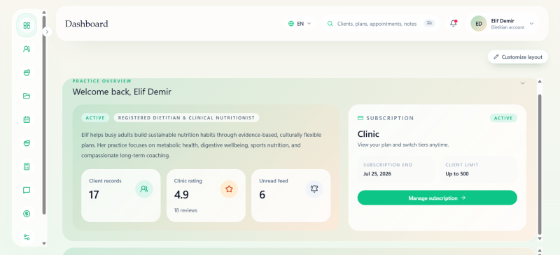
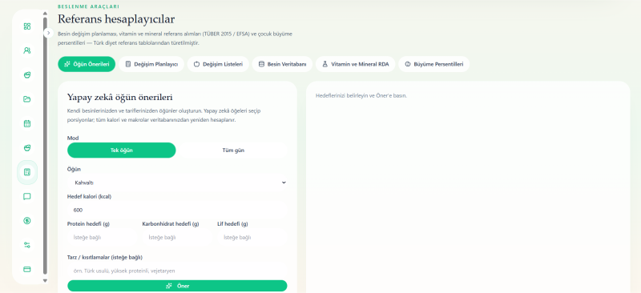
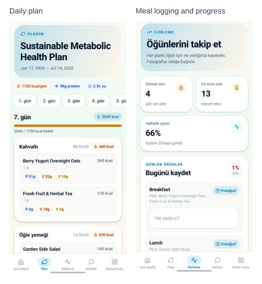
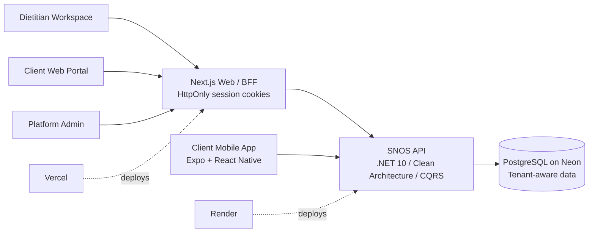
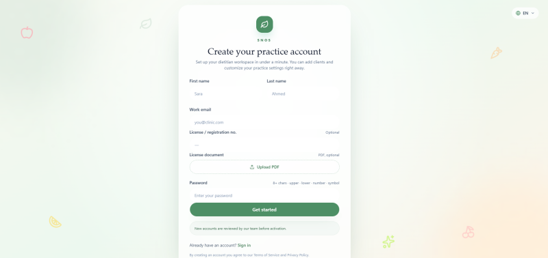

# Smart Nutrition Operating System (SNOS)

> **A multi-tenant operating system for modern nutrition practices.**
>
> One connected workspace for clinical records, nutrition tools, diet planning, client follow-up, communication, and practice management—with web and mobile access for clients.

### [🌐 View Live Demo](https://snos-phi.vercel.app/welcome)

*The centralized dietitian workspace for client care and daily practice operations.*

## The product

SNOS was initiated in response to a practicing dietitian's need to manage client care and nutrition planning in one place. It began as a project for a university E-Commerce class and continued development after the class ended.

Client records, nutrition references, meal plans, appointments, and follow-up often sit in separate tools. SNOS brings these workflows together so dietitians can move from clinical review to planning and client communication within the same workspace.

- **A single clinical record:** client profiles, anamnesis, measurements, blood tests, report attachments, and progress history.
- **Nutrition tools and planning:** energy and macro calculations, micronutrient targets, growth reference tools, food exchanges, and structured diet plans.
- **Food data and reusable workflows:** USDA food references, manual food entry, recipes, and plan templates. AI-assisted meal suggestions have nutrient values recalculated from stored food data.
- **Plan delivery:** printable plans and shopping lists help clients use their plan outside the application.
- **Continuous follow-up:** appointments and client requests, messaging, notifications, meal-photo reviews, water and sleep logs, and progress dashboards.
- **Practice management:** subscription packages and feature limits, billing and payment records, dietitian approval, account administration, and configurable branding. English, Turkish, and Arabic interfaces include RTL support.

Practicing dietitians have tried the free demo and reported a more convenient workflow and time savings. This feedback is qualitative; time savings have not been formally measured.

*Nutrition references and planning tools alongside AI-assisted meal suggestions.*

[Full daily plan screenshot](docs/images/snos/mobile-plan.jpeg) · [Full progress screenshot](docs/images/snos/mobile-progress.jpeg) · [Earlier mobile plan screen](docs/images/snos/mobile-client-app.jpeg)

*The companion app lets clients follow their plan, record meals and daily habits, maintain streaks, and communicate with their dietitian.*

## Architecture & full-stack scope

Each tenant is associated with one dietitian account. Tenant-aware access policies and EF Core query filters scope data to the relevant dietitian, while role-based interfaces serve dietitians, clients, and platform administrators. Branding can be customized for a practice; shared accounts for multiple dietitians within one clinic are not yet implemented.

### Backend foundation

The backend separates Domain, Application, Infrastructure, and API layers. CQRS with MediatR organizes commands and queries, FluentValidation handles application validation, and EF Core migrations manage the PostgreSQL schema. Authentication uses JWT access tokens and refresh-token flows; the Next.js BFF handles web sessions through HttpOnly cookies.

The data model connects clients, clinical records, plans, food references, appointments, engagement logs, messages, and billing records. PostgreSQL on Neon provides a shared cloud database for development.

### Quality and delivery controls

Validation combines backend xUnit tests, web Vitest tests, Playwright browser journeys, and manual scenario checks. The web frontend is hosted on Vercel and the API on Render. Continued development includes regression coverage, startup recovery, and deployment reliability work; the current demo's hosting still needs improvement.

The private application repository includes a GitHub Actions workflow configured for backend builds and xUnit tests, migration-script generation, dependency checks, and Docker builds. Web checks include linting, Vitest, a production build, and a dependency audit; the mobile job runs TypeScript checks.

### Product applications

| Surface | Primary outcome |
|---|---|
| **Dietitian web workspace** | Manage clinical records, nutrition tools, diet plans, appointments, communication, billing records, and practice settings. |
| **Client web portal** | Access plans, appointments, progress, messages, notifications, and profile information. |
| **Mobile companion** | Follow plans and log meals, photos, water, sleep, and progress while communicating with the dietitian. |
| **Platform admin** | Review dietitian accounts and manage platform users and subscription packages. |

*Practice account registration with optional professional document submission and an account review step.*

All screenshots are from earlier demo builds with sample client and health data. Package values, ratings, and progress figures are illustrative.

## Team structure & my contributions

SNOS was developed by three people. I worked across the backend and web application, sharing architecture and implementation work with a teammate. Another teammate primarily implemented the mobile app; my role there focused on requirements, direction, and reviewing the client experience.

- **Requirements and data model:** gathered practitioner needs, defined the initial tables and relationships, and adapted them as requirements evolved.
- **Architecture and implementation:** researched the platform foundation and contributed to authentication, client and clinical records, nutrition planning, package and checkout flows, billing records, and administration.
- **Nutrition workflows:** translated practitioner-provided formulas and reference materials into calculation and planning requirements.
- **Testing and maintenance:** took primary responsibility for initial manual scenario testing, reported and fixed issues, and continued with regression coverage and deployment reliability work.
- **Mobile direction:** defined features and reviewed plan access, meal logging, communication, and progress tracking.

## Current demo & roadmap

SNOS is a free demo under active development. It has been tried by practicing dietitians, but paid subscriptions and real payment collection are not enabled. Shopier integration code exists; provider setup and payment validation are still needed.

The mobile app has been tested on physical Android phones. Physical iOS testing remains unverified.

### Next steps

- **Deployment and user experience:** improve hosting reliability, startup recovery, and everyday workflows.
- **Disease-specific planning:** add requirements and calculation support for conditions such as diabetes and hypertension; this is not yet integrated.
- **Paid subscriptions:** complete provider setup and validate checkout and collection before enabling payments.
- **Shared clinic accounts:** explore multiple dietitian accounts within one clinic as a future extension.

---

This repository presents the SNOS project and its screenshots. Application source code and setup instructions remain private.
