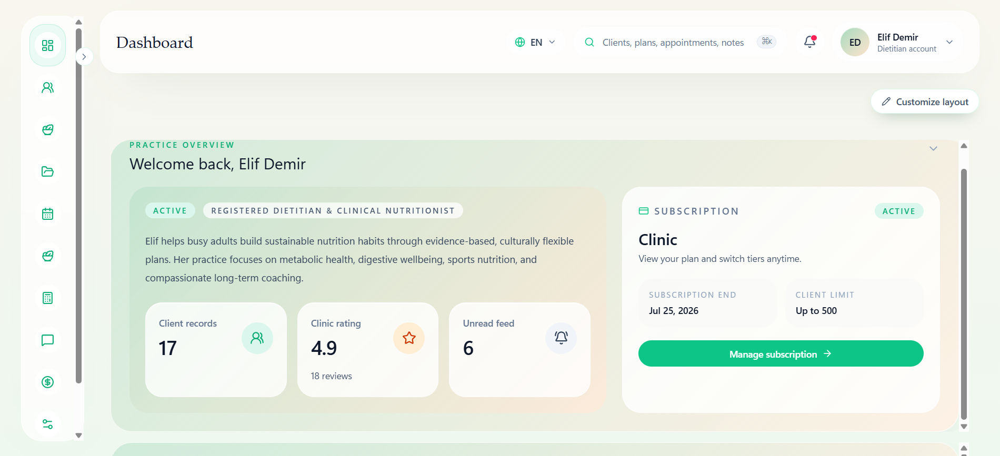
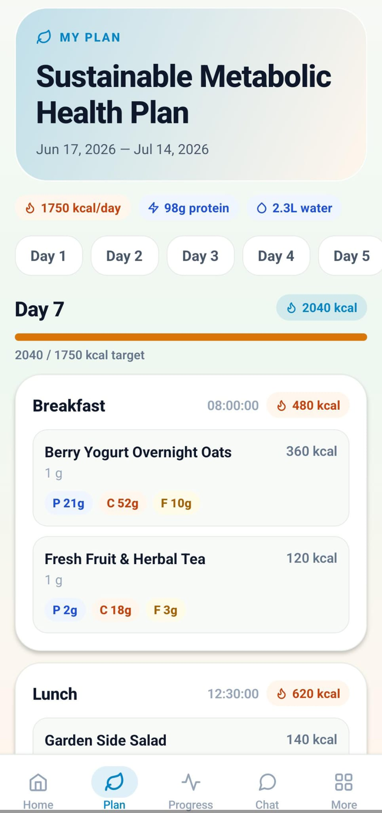
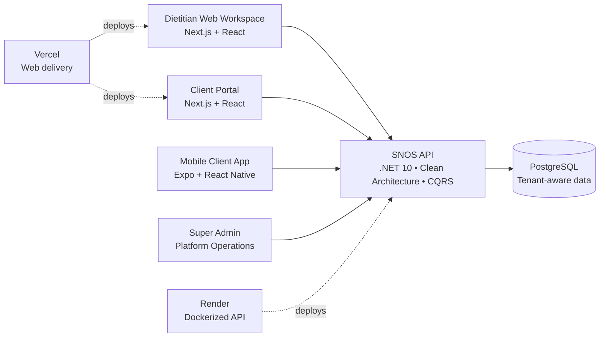
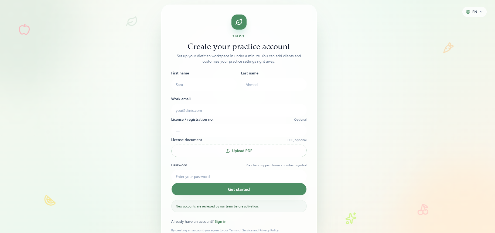

# Smart Nutrition Operating System (SNOS)

> **A multi-tenant operating system for modern nutrition practices.**  
> SNOS gives dietitians one connected workspace to manage clients, turn clinical context into practical diet plans, and keep clients engaged between appointments.

### [🌐 View Live Staging Environment](https://snos-phi.vercel.app/welcome)

   
  <em>The centralized dietitian workspace for client management and daily clinical operations.</em>

## The product

Dietitians often have to piece together client files, measurements, meal plans, appointments, messaging, and follow-up work across disconnected tools. That fragmentation costs time, weakens continuity of care, and makes a growing practice harder to operate consistently.

SNOS is designed from the workflow outward. Requirements were gathered directly from practicing dietitians and translated into one purpose-built platform for the complete nutrition-care lifecycle:

- **A single client record:** anamnesis, measurements, blood tests and report attachments, progress history, appointments, billing context, and engagement data in one workspace.
- **Actionable nutrition planning:** structured diet-plan creation, macro energy splits, nutrient budgets, food-exchange calculations, shopping lists, printable plans, and reusable planning workflows.
- **A practical food intelligence layer:** a self-hosted USDA reference database with roughly 8,300 foods, searchable nutrient data, household portions, and diet-plan integration.
- **Continuous client engagement:** a client portal and companion mobile experience for viewing plans, tracking progress, requesting appointments, communicating, and submitting meal-related updates.
- **Practice-ready localization and branding:** English, Turkish, and Arabic interfaces with RTL support, plus tenant-level brand color and logo configuration.

The result is not simply a diet-plan generator. It is the operational backbone for a nutrition practice—from intake and clinical review through adherence, communication, and repeatable delivery.

   
  <em>Client-facing mobile interface displaying the structured daily diet plan for easy on-the-go access.</em>

## Architecture & full-stack scope

SNOS is built as a multi-tenant SaaS ecosystem. Each dietitian operates within an isolated tenant context, while role-based experiences serve dietitians, clients, and platform administrators.

### Backend foundation

The API follows Clean Architecture with explicit `Domain → Application → Infrastructure → API` dependency boundaries. CQRS with MediatR keeps commands and queries focused; FluentValidation enforces application-level rules; and thin controllers preserve a clean HTTP boundary.

Multi-tenancy is enforced through tenant-aware identity and Entity Framework global query filters. JWT access tokens, refresh-token flows, role-based authorization policies, rate limiting, and client-scoped portal endpoints provide the security model for the product surface. PostgreSQL and Entity Framework Core support a relational model tailored to nutrition workflows, including clients, plans, plan items, clinical records, files, appointments, engagement, billing, and reference data.

The API is containerized and deployed to Render, with migrations executed as a pre-deploy step and a readiness health check. The web application is deployed to Vercel. This gives the staging environment a production-shaped delivery path while keeping the platform independently deployable across services.

### Quality and delivery controls

The repository includes a GitHub Actions CI workflow that runs on pull requests and pushes to `main`. It validates the backend through restore, Release build, xUnit tests with XPlat code coverage collection, idempotent EF migration-script generation, vulnerable-package checks, and a Docker build. The frontend workflow runs a clean dependency install, linting, Vitest tests, production build, critical npm audit, and Docker build.

This is supported by a dedicated .NET application test project and frontend Vitest tests for product code—evidence of automated verification integrated into the development path, rather than an undocumented quality claim.

### Product applications

| Surface | Primary outcome |
|---|---|
| **Dietitian web workspace** | Run daily client care: intake, clinical records, diet planning, schedules, billing, communications, and practice settings. |
| **Client portal** | Give clients secure access to their plan, appointments, progress, messages, notifications, and profile. |
| **Mobile app** | Extend the client experience into a mobile-first companion for plans, progress, appointment requests, and engagement. |
| **Super-admin capability** | Support platform-level operations across the SaaS environment. |

   
  <em>Secure B2B onboarding flow requiring professional dietitian license verification.</em>

## Team structure & my contributions

SNOS was built by a tight-knit **three-person development team** with a shared full-stack mindset. Each team member contributed across the web frontend, backend, mobile application, and database concerns, enabling the product to evolve as one connected system rather than as isolated workstreams.

- **Guided domain-to-technical alignment:** acted as the primary bridge to dietitians, gathering requirements, resources, and clinical logic directly from domain experts and translating them into clear technical direction for the team.
- **Contributed to the platform foundation:** helped shape the relational, tenant-aware data model and built the majority of the backend infrastructure, including the architecture, application flows, security model, persistence, migrations, and deployment readiness.
- **Worked across every product surface:** contributed alongside the team to the Next.js web application, Expo/React Native mobile client, super-admin capabilities, and the integrations that connect them.
- **Made nutrition workflows product-ready:** collaborated on turning food-reference data, macro and micronutrient context, localized food exchanges, clinical records, document attachments, printable artifacts, and client engagement into usable practice workflows.
- **Coordinated shared delivery:** helped keep product priorities, technical decisions, and implementation moving together across frontend, backend, mobile, database, and DevOps work—including the CI validation and deployment configuration present in the repository.

The project reflects a collaborative, end-to-end effort: combining direct practitioner insight, shared engineering ownership, and coordinated execution to build a system that works for the people it serves.

## Production-ready MVP

SNOS is deployed in a live pre-launch/staging environment, with the frontend on Vercel and the backend API on Render. The current release is a **production-ready MVP**: it has the architectural boundaries, security foundations, multi-tenant model, operational workflows, and deployment posture needed to validate the product with real practices and prepare for market entry.

### Roadmap

- **Payment gateway integration** — enable subscription and payment flows directly within the platform.
- **Commercial launch** — move from pre-launch validation to onboarding nutrition practices at scale.

---

SNOS demonstrates how disciplined domain discovery, intentional architecture, and full-stack leadership can turn a specialized professional workflow into a scalable SaaS product.
