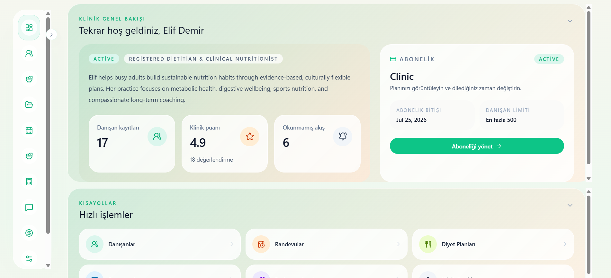
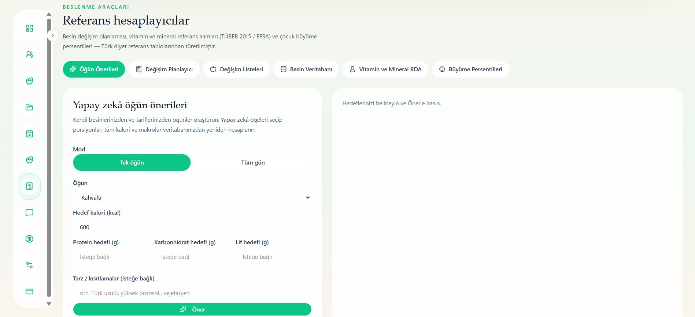

# Smart Nutrition Operating System (SNOS)

A multi-tenant SaaS platform for nutrition care and dietitian practice management. It brings together clinical records, nutrition tools, diet planning, client follow-up, communication, and billing workflows, with client access through web and mobile apps.

[Live demo](https://snos-phi.vercel.app/welcome) · [GitHub repository](https://github.com/MahmoudAllabani/multi-tenant-dietitian-saas-platform)

**Stack:** .NET 10 / ASP.NET Core · Next.js 16 / React / TypeScript · PostgreSQL / EF Core · Expo / React Native

## Background

SNOS was initiated in response to a practicing dietitian's need for an integrated workspace for client care and practice management. It began as a project for a university E-Commerce class and continued development after the class ended.

Practicing dietitians have tried the free demo and reported a more convenient workflow and time savings. Their feedback is qualitative; time savings have not been formally measured.

## My contribution

I contributed across the backend and web application, sharing architecture and implementation work with a teammate.

- **Requirements and data model:** gathered practitioner needs, defined the initial tables and relationships, and adapted them as the product evolved.
- **Architecture and implementation:** researched the platform foundation and contributed to authentication, client and clinical records, diet planning, package flows, billing records, and administration.
- **Nutrition tools:** translated practitioner-provided formulas and reference materials into calculation and planning requirements.
- **Validation and maintenance:** took primary responsibility for initial manual scenario testing and continued with fixes, regression coverage, and deployment reliability work.
- **Mobile direction:** defined requirements and reviewed the client experience; another teammate primarily implemented the mobile app.

## Main features

- **Clinical records:** client profiles, anamnesis, measurements, blood tests, and report attachments.
- **Nutrition tools and planning:** energy and macro calculations, micronutrient targets, growth reference tools, food exchanges, USDA food data, manual food entry, recipes, and reusable templates.
- **Plan delivery:** printable plans, shopping lists, and AI-assisted meal suggestions with nutrient values recalculated from stored food data.
- **Coordination and follow-up:** appointments and client requests, messaging, notifications, meal-photo reviews, daily logs, and progress dashboards.
- **Client web and mobile access:** plans, messages, meal photos, water and sleep logs, and streaks, connected to the dietitian workspace.
- **Practice and platform management:** subscription packages and feature limits, billing and payment records, dietitian approval and account administration, branding, and English/Turkish/Arabic interfaces with RTL support.

## Technical approach

| Area | Implementation |
|---|---|
| Backend | Domain, Application, Infrastructure, and API layers; CQRS with MediatR and FluentValidation. |
| Data and tenancy | PostgreSQL on Neon, EF Core migrations, tenant-aware access policies, and query filters scoped to each dietitian. |
| Authentication | JWT and refresh-token flows; a Next.js BFF with HttpOnly cookies for web sessions. |
| Validation | Backend xUnit tests, web Vitest tests, Playwright browser journeys, and manual scenario checks. |
| Delivery | Vercel web frontend and Render API; ongoing work on startup recovery and hosting reliability. |

## Screenshots

Earlier demo builds with sample client and health data; package values and progress figures are illustrative.

### Dietitian workspace

### Nutrition tools

### Client mobile app

[Full daily plan screenshot](docs/images/snos/mobile-plan.jpeg) · [Full progress screenshot](docs/images/snos/mobile-progress.jpeg)

## Current status and next steps

SNOS is a free demo under active development.

- **Payments:** Shopier integration code exists, but collection is not enabled and no money is collected.
- **Mobile:** tested on physical Android phones; physical iOS testing remains unverified.
- **Scope:** each tenant belongs to one dietitian. Shared clinic accounts and disease-specific planning are not implemented.

Ongoing work focuses on deployment reliability and the user experience. Disease-specific nutrition planning for conditions such as diabetes and hypertension is planned. Paid subscriptions require provider setup and payment validation; shared clinic accounts remain a possible extension.
